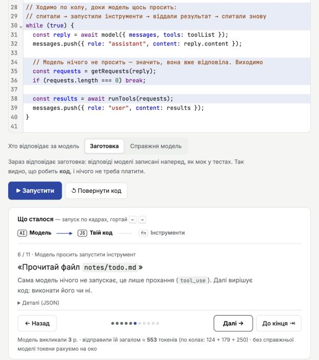

<div align="center">

# Агентура

**Інтерактивний курс українською про те, як влаштовані AI-агенти**

Спершу збираємо агента з нуля, а потім маленьку фабрику агентів:<br>
задача з трекера → агент пише код → перевірки → merge request.

[](LICENSE)
[](https://nodejs.org)
[](#)
[](#уроки)



</div>

## Як це виглядає

Кожен урок — сторінка в браузері: трохи тексту, код і кнопка «Запустити». Після запуску по кадрах видно, що відбувається: що код відправив моделі, що вона попросила, який інструмент запустився і що повернулось назад.

Код можна змінювати і запускати скільки завгодно. Він виконується прямо в браузері, а файли, з якими працює агент, віртуальні, тож справжній диск він не зачепить.

## Уроки

|     | Урок                                | Про що                                                    |
| :-: | ----------------------------------- | --------------------------------------------------------- |
| ✅  | **1. Як влаштований агент**         | модель, інструменти, інструкція і цикл — з нуля, 9 кроків |
| ⏳  | **2. Міні-трекер**                  | агент бере задачу з трекера і рухає її статус             |
| ⏳  | **3. Міні-git**                     | гілка, коміт, merge request; мерджить людина              |
| ⏳  | **4. Правила проєкту**              | `CLAUDE.md` і скіли                                       |
| ⏳  | **5. Перевірка якості**             | тести як CI і агент-рев'юер                               |
| ⏳  | **6. Пошук знань**                  | векторний пошук по міні-вікі                              |
| ⏳  | **7. Граф знань**                   | хто за що відповідає і що від чого залежить               |
| ⏳  | **8. Міні-фабрика**                 | ти створюєш задачу, агенти доводять її до MR              |

Курс у роботі: нові уроки з'являтимуться поступово.

## Швидкий старт

Потрібен [Node.js](https://nodejs.org) 20.12 або новіший (перевірити: `node -v`) і Git.

```bash
git clone https://github.com/eurusik/agentura.git
cd agentura
npm install
npm run lab
```

Відкрий **http://localhost:4321** і починай з уроку 1. Зупинити лабораторію — `Ctrl+C` у терміналі.

Ні ключів, ні моделі не потрібно: уроки працюють на заготовлених відповідях моделі, без інтернету і безкоштовно.

## Справжня модель (за бажанням)

Під кодом у кожному кроці є перемикач «Заготовка / Справжня модель». Щоб той самий код керував живою моделлю, підключи один із варіантів. Ця ж інструкція є в самій лабораторії: головна → «Як підключити свою модель».

<details>
<summary><b>Ollama</b> — локально і безкоштовно</summary>

<br>

Модель працює прямо на твоєму комп'ютері, ключ не потрібен. Потрібно близько 16 ГБ оперативної пам'яті і 5 ГБ на диску.

1. **Постав Ollama.** Програма для macOS, Windows і Linux є на [ollama.com/download](https://ollama.com/download). На macOS можна через Homebrew:

   ```bash
   brew install ollama
   brew services start ollama
   ```

2. **Завантаж модель** (близько 5 ГБ, один раз):

   ```bash
   ollama pull qwen3:8b
   ```

3. **Перевір:** `ollama list` має показати `qwen3:8b`.

4. **У лабораторії** перемкнись на «Справжня модель» і натисни «Перевірити ще раз». Перезапускати нічого не треба.

Перша відповідь може йти 10–30 секунд, поки модель завантажується в пам'ять, далі буде кілька секунд. Чому саме `qwen3:8b`: на завданнях з уроку вона доводила задачу до кінця, менші моделі часто кидали її на півдорозі. «Думання» в моделей Qwen лабораторія вимикає сама.

</details>

<details>
<summary><b>Хмарний API з безкоштовним лімітом</b> — OpenRouter, Groq, Gemini</summary>

<br>

Підходить, якщо комп'ютер слабкий.

1. Зареєструйся на сайті сервісу і створи API-ключ.
2. Скопіюй файл з налаштуваннями (на Windows: `copy .env.example .env`):

   ```bash
   cp .env.example .env
   ```

3. Відкрий `.env`, розкоментуй блок свого сервісу і впиши ключ (`OPENAI_API_KEY`) і назву моделі (`OPENAI_MODEL`) з сайту сервісу. Обирай модель, яка вміє працювати з інструментами (tool calling).
4. Перезапусти лабораторію: `Ctrl+C`, потім знову `npm run lab`.

</details>

<details>
<summary><b>Claude від Anthropic</b> — платно</summary>

<br>

Найрозумніша з трьох, проходить усі кроки без пригод. Урок коштує частки цента.

1. `cp .env.example .env`
2. У `.env` розкоментуй `ANTHROPIC_API_KEY=` і впиши ключ з [console.anthropic.com](https://console.anthropic.com).
3. Перезапусти лабораторію.

</details>

Якщо заповнено кілька варіантів, лабораторія бере перший у такому порядку: Claude → хмарний API → Ollama. Файл `.env` є в `.gitignore`, а ключі бачить тільки сервер лабораторії на твоєму комп'ютері, у браузер вони не передаються.

<details>
<summary><b>Якщо не працює</b></summary>

<br>

| Що бачиш                                                    | Що зробити                                                                                                                                  |
| ----------------------------------------------------------- | ------------------------------------------------------------------------------------------------------------------------------------------- |
| «Справжня модель · не підключена», хоча Ollama стоїть       | Перевір, що Ollama запущена: `ollama list` має показати список без помилок. На macOS: `brew services start ollama` або відкрий програму Ollama. |
| «Ollama запущена, але моделей у ній немає»                  | `ollama pull qwen3:8b`                                                                                                                      |
| «У .env бракує: …»                                          | Заповни всі три рядки `OPENAI_…` у `.env` і перезапусти лабораторію.                                                                        |
| «OPENAI_BASE_URL має бути повною адресою»                   | Адреса має починатися з `https://`. Скопіюй її з `.env.example`.                                                                            |
| Помилка `EADDRINUSE` при `npm run lab`                      | Порт 4321 зайнятий. Запусти на іншому: `PORT=4322 npm run lab` (на Windows: `set PORT=4322 && npm run lab`).                               |
| Модель відповідає дуже довго                                | Перша відповідь завжди довша. Якщо кожна йде по хвилині, перевір, що використовуєш `qwen3:8b`.                                              |
| Модель зупиняється на півдорозі або просить не той інструмент | Для маленьких моделей це нормально, тому в коді агента і є обмеження спроб і перевірки. Спробуй ще раз або підключи більшу модель.         |

</details>

## Для кого

Для тих, хто користується Claude Code, Cursor чи ChatGPT і хоче зрозуміти, що відбувається всередині. Базове знання JavaScript допоможе, але глибоко розбиратись у ньому не треба.

## Для тих, хто хоче покопатись у коді

<details>
<summary><b>Як влаштований проєкт</b></summary>

<br>

```
lab/
  server.ts            роздає сторінки і пересилає запити до справжньої моделі (ключі лишаються тут)
  providers.ts         знаходить підключену модель (Claude / OpenAI-сумісна / Ollama) і перекладає формати
  public/
    index.html, home.js         головна: список уроків
    lesson.html, lesson-app.js  сторінка будь-якого уроку (lesson.html?l=1)
    setup.html                  як підключити справжню модель
    app/        спільний інтерфейс: редактор, кадри, блок «Що сталося», крок, статус моделі
    runtime/    спільний «двигун»: виконує код уроку у Web Worker, model(), віртуальна папка /work
    lessons/
      index.js           реєстр курсу: номер, назва, опис і статус кожного уроку
      01-agent/          урок 1
        lesson.js          назва, мета, порядок кроків, тест
        sandbox.js         пісочниця уроку: файли на старті, інструменти, заготовка моделі
        steps/NN-*.js      один крок = один файл: текст, підказки, «Покрути»
        code/NN-*.js       код кроку (і NN-*-fix.js — виправлення), який видно в редакторі
src/, playground/, tracker/, sandbox/   заготовки для наступних уроків
test/                   тести
```

</details>

<details>
<summary><b>Як додати урок</b></summary>

<br>

1. Створи папку `lab/public/lessons/NN-назва/` за зразком `01-agent`: `lesson.js`, `sandbox.js`, `steps/`, `code/`.
2. У `lab/public/lessons/index.js` постав уроку `status: "ready"`.

Спільний код (`app/`, `runtime/`) для нового уроку чіпати не треба: усе, що відрізняється між уроками (файли, інструменти, поведінка заготовки), живе в `sandbox.js` самого уроку.

</details>

<details>
<summary><b>Заготовки для наступних уроків</b></summary>

<br>

Робочий код, з якого виростуть наступні уроки. Лабораторія його поки не використовує, але на нього є тести.

- `src/p0/` — агент з уроку 1 як програма для терміналу: `npm run p0 -- --model stub --script normal`.
- `src/p2/` + `tracker/` — маленький трекер задач і MCP-сервер до нього.
- `playground/` — крихітний проєкт з `CLAUDE.md`, скілом і командою, щоб пробувати це в Claude Code.
- `sandbox/` — папка-пісочниця для термінального агента з `src/p0`.

</details>

<details>
<summary><b>Команди</b></summary>

<br>

| Команда                | Що робить                                      |
| ---------------------- | ---------------------------------------------- |
| `npm run lab`          | запустити лабораторію на http://localhost:4321 |
| `npm test`             | тести                                          |
| `npm run typecheck`    | перевірка типів                                |
| `npm run format`       | відформатувати код (Prettier)                  |
| `npm run format:check` | перевірити форматування                        |

</details>

## Ліцензія

[MIT](LICENSE)
